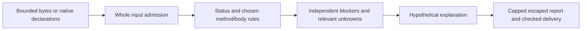

# HTTP redirect policy lab

An offline Python teaching model for a hypothetical next redirect step. It explains
method preservation or rewriting, body discard versus replayability, and declared
client-policy blockers. A known stop does not erase a relevant unknown. No request is
built or sent; supplied origin relation and policy are assumptions, not authority.

## Run

No runtime dependencies. Verified on Windows CPython 3.13.7; other runtimes/platforms
not tested. From this directory:

```powershell
python -m redirectlab fixtures/cases.json
python -m redirectlab fixtures/cases.json --format markdown --output demo.md
python -m unittest discover -s tests -v
python -O -m unittest discover -s tests -v
```

The 40-case demo intentionally exits **2**: 26 supported and 14 unsupported results.
Exit0 means supported explanations, including would-stop decisions; exit2 also covers
argument errors; exit1 invalid input or delivery failure. Help0 requires successful
delivery. Output files must be fresh; existing destinations/input aliases are rejected.
See the saved [JSON demo](reports/verification-reviewed/demo.json) and
[Markdown demo](reports/verification-reviewed/demo.md).

API: `redirectlab.parse(raw_bytes)` admits bounded JSON syntax, then
`redirectlab.evaluate(native_document)` validates the entire native/schema document
before semantics. Evaluate works independently of parse and returns fresh declarations,
fixed rule provenance, sorted blockers/unknowns and a hypothetical next step.
[CONTRACT.md](CONTRACT.md) fixes every schema, error/order/null field and bound.

## Behavior

| Input | Explained result |
| --- | --- |
| POST301/302 with get/preserve choice | Explicit GET/drop or POST/preserve policy |
| 307/308 | Preserve method; assess declared body replayability separately |
| 303 | Chosen HEAD-for-HEAD, GET-otherwise retrieval; drop body |
| PUT/DELETE with unsafe_replay deny | Stop even though these methods are idempotent |
| Manual policy plus unknown body replayability | Would stop, status unsupported, proposal retained |
| POST301/302 with unknown method choice | No invented body or unsafe replay conclusion |

Standards allow optional following and POST rewriting; the selected profile is narrower
than a general HTTP client. 200/201/204/304 are explicit non-follow controls in this lab.
No URLs, raw Location, body bytes, header values, credentials or actual streams occur
in input. A caller-supplied allow declaration never grants execution permission.



`contracts.py` owns admission; `model.py` owns conditional explanations; `report.py`
owns inert serialization/fresh files; `__main__.py` owns checked streams/exits.
There is no execution adapter or network service.

## Evidence and limits

[VERIFICATION.md](VERIFICATION.md): 19 tests normal/optimized/restored, 40 full independent
pre-code reports, 15 diagnostics, 105 independent finite controls, five assertion-detected
semantic mutations with exact restoration, compilation and Bandit zero findings/errors.
Two admitted 40-case stress profiles stayed below the ordinary cap; reduced-cap seams
tested rejection. These measurements do not establish a maximum or reachable ordinary-
cap overflow. Real closed-pipe processes, closed Python streams and injected seams are
reported separately. Windows/this runtime only; synthetic tests are not conformance
or production assurance. [SECURITY.md](SECURITY.md) describes trusted host/path/stream,
partial-output, cleanup, race and resource-sandbox limits.

[RESEARCH.md](RESEARCH.md) records pinned Requests/HTTPX source/test/license/dependency/
defined-CI review and the decision to build a normalized stdlib model. No upstream code
or test vectors adopted/executed. Owned MIT media/range admission/report/CLI and verifier/
test scaffolding adapted locally with attribution; retained snapshots document reuse.
Private research captures/licenses/NOTICE are evidence, not a publication step.
MIT licensed. AI assistance: Codex implemented and self-reviewed; local Ollama
qwen3.5:2b supplied three source-checked research reminders. No independent audit or
real-client/network test claimed. [REVIEW.md](REVIEW.md), [DECISIONS.md](DECISIONS.md) and
[LEARNING.md](LEARNING.md) retain review, tradeoffs and concepts.

## Publication status

See [publication review](PUBLICATION.md) for the October 5 source snapshot, fresh local checks, evidence boundaries and current hosted-check distinction.
